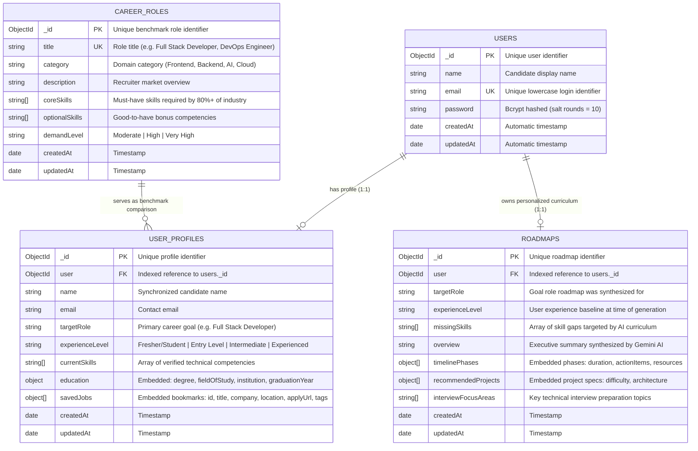

# Technical Architecture: MongoDB Database Schema & Data Persistence Model

---

## 1. Executive Summary & Design Philosophy
The AI-Based Career and Skill Gap Analyzer uses a **production-grade hybrid data architecture**. Rather than forcing all application data into relational tables or permanently storing rapidly expiring external records, the system cleanly separates data into two distinct operational tiers:

1. **Persistent Tier (MongoDB & Mongoose)**:
   - Stores long-lived user identity, personal career preferences, acquired skills, custom saved bookmarks, benchmark industry skill standards, and AI-generated learning curriculums.
2. **Ephemeral / Computed Tier (RAM & Real-Time APIs)**:
   - Fetches live market postings on-demand via public APIs.
   - Evaluates dynamic skill match compatibility scores in real time.
   - Parses resume binary buffers in memory without saving raw files.

This separation prevents database bloat, eliminates stale records, guarantees sub-50ms dashboard read operations, and fits within MongoDB community limits.

---

## 2. Entity-Relationship (ER) Architecture Diagram

---

## 3. Detailed MongoDB Collection Specifications

### 3.1. Collection: `users`
- **Model File**: [`backend/models/User.js`](file:///c:/Users/aksha/Desktop/AI_based_Skill_Gap_Analyzer/AI-based-Career-and-Skill-Gap-analyzer/backend/models/User.js)
- **Collection Name in MongoDB**: `users`
- **Purpose**: Manages authentication, identity, and security credentials.

| Field | Type | Validation / Constraints | Description |
| :--- | :--- | :--- | :--- |
| `_id` | `ObjectId` | Auto-generated primary key | Unique user identifier. |
| `name` | `String` | `required: true, trim: true` | Candidate full name. |
| `email` | `String` | `required: true, unique: true, lowercase: true, regex valid` | Account email credential. |
| `password` | `String` | `required: true, minlength: 6` | Bcrypt salted hash. Never stored in plain text. |
| `createdAt` | `Date` | Mongoose timestamps | Account registration date. |
| `updatedAt` | `Date` | Mongoose timestamps | Last profile security update date. |

- **Security Hooks**:
  - `pre("save")`: Automatically salts and hashes `password` with `bcrypt.hash(password, 10)` whenever modified.
  - `matchPassword(entered)`: Compares entered plain-text against stored hash using `bcrypt.compare`.

---

### 3.2. Collection: `userprofiles`
- **Model File**: [`backend/models/UserProfile.js`](file:///c:/Users/aksha/Desktop/AI_based_Skill_Gap_Analyzer/AI-based-Career-and-Skill-Gap-analyzer/backend/models/UserProfile.js)
- **Collection Name in MongoDB**: `userprofiles`
- **Purpose**: Central state representing candidate skills, education, target role, and user-bookmarked job opportunities.

| Field | Type | Validation / Constraints | Description |
| :--- | :--- | :--- | :--- |
| `_id` | `ObjectId` | Primary Key | Unique document identifier. |
| `user` | `ObjectId` | `ref: "User", index: true` | Foreign key linking to `users._id`. |
| `name` | `String` | `required: true, trim: true` | Candidate name. |
| `email` | `String` | `required: true, lowercase: true` | Contact email. |
| `targetRole` | `String` | `required: true, trim: true` | Primary career target (e.g. *"Full Stack Developer"*). |
| `currentSkills` | `[String]` | `default: []` | Normalized array of skills (e.g. `["React", "Node.js", "MongoDB"]`). |
| `experienceLevel`| `String` | `enum: ["Fresher/Student", "Entry Level", "Intermediate", "Experienced"]` | Professional level. Defaults to `"Fresher/Student"`. |
| `education` | `Object` | Sub-document | Candidate academic credentials. |
| `education.degree` | `String` | `trim: true, default: ""` | Degree name (e.g., *"B.Tech Computer Science"*). |
| `education.fieldOfStudy` | `String` | `trim: true, default: ""` | Discipline (e.g., *"Software Engineering"*). |
| `education.institution` | `String` | `trim: true, default: ""` | University or College name. |
| `education.graduationYear` | `Number` | Optional | Year of graduation (e.g., `2026`). |
| **`savedJobs`** | `[Object]` | Embedded Array | Bookmarked opportunities saved by candidate. |
| `savedJobs[].id` | `String` | `required: true` | Unique posting ID from external feed. |
| `savedJobs[].title` | `String` | `required: true` | Job title. |
| `savedJobs[].company` | `String` | `required: true` | Employer company name. |
| `savedJobs[].location` | `String` | `default: "Remote"` | Work location or remote availability. |
| `savedJobs[].isRemote` | `Boolean` | `default: false` | Remote flag. |
| `savedJobs[].applyUrl` | `String` | `required: true` | Direct URL to original employer application form. |
| `savedJobs[].tags` | `[String]` | `default: []` | Key technical requirements extracted from posting. |
| `savedJobs[].descriptionSnippet` | `String` | `default: ""` | Plain text preview summary. |
| `savedJobs[].source` | `String` | `default: "API"` | Origin board (`"Arbeitnow"`, `"Remotive"`, `"Verified Partner"`). |
| `savedJobs[].savedAt` | `Date` | `default: Date.now` | Timestamp when user bookmarked the job. |

---

### 3.3. Collection: `careerroles`
- **Model File**: [`backend/models/CareerRole.js`](file:///c:/Users/aksha/Desktop/AI_based_Skill_Gap_Analyzer/AI-based-Career-and-Skill-Gap-analyzer/backend/models/CareerRole.js)
- **Collection Name in MongoDB**: `careerroles`
- **Purpose**: Pre-seeded industry benchmark catalog. Serves as ground truth for skill gap evaluations.

| Field | Type | Validation / Constraints | Description |
| :--- | :--- | :--- | :--- |
| `_id` | `ObjectId` | Primary Key | Unique role document ID. |
| `title` | `String` | `required: true, unique: true, trim: true` | Canonical title (e.g., *"Full Stack Developer"*). |
| `category` | `String` | `required: true, trim: true` | Discipline category (e.g., *"Web Development"*). |
| `description` | `String` | `required: true, trim: true` | Role overview and daily responsibilities. |
| `coreSkills` | `[String]` | `validate: length > 0` | Mandatory skills demanded by 80%+ of recruiters. |
| `optionalSkills` | `[String]` | `default: []` | Secondary skills that improve candidate competitiveness. |
| `demandLevel` | `String` | `enum: ["Moderate", "High", "Very High"]` | Real-world hiring market demand. |

---

### 3.4. Collection: `roadmaps`
- **Model File**: [`backend/models/Roadmap.js`](file:///c:/Users/aksha/Desktop/AI_based_Skill_Gap_Analyzer/AI-based-Career-and-Skill-Gap-analyzer/backend/models/Roadmap.js)
- **Collection Name in MongoDB**: `roadmaps`
- **Purpose**: Persists personalized 12-week learning plans synthesized by Google Gemini AI.

| Field | Type | Validation / Constraints | Description |
| :--- | :--- | :--- | :--- |
| `_id` | `ObjectId` | Primary Key | Unique roadmap document ID. |
| `user` | `ObjectId` | `ref: "User", required: true, index: true` | Owner user ID. |
| `targetRole` | `String` | `required: true, trim: true` | Target career title. |
| `experienceLevel`| `String` | `default: "Fresher/Student"` | Baseline candidate level. |
| `missingSkills` | `[String]` | `default: []` | Specific skill deficiencies addressed. |
| `overview` | `String` | `required: true` | Executive summary synthesized by Gemini AI. |
| `timelinePhases` | `[Object]` | Embedded Array | Structured phase-by-phase learning sequence. |
| `timelinePhases[].phaseNumber` | `Number` | `required: true` | Sequential index (e.g., `1`, `2`, `3`). |
| `timelinePhases[].title` | `String` | `required: true` | Phase theme (e.g., *"Core Backend Architecture"*). |
| `timelinePhases[].duration` | `String` | `required: true` | Timeframe (e.g., *"Weeks 1–3"*). |
| `timelinePhases[].focusSkills` | `[String]` | `default: []` | Competencies developed in this phase. |
| `timelinePhases[].actionItems` | `[Object]` | `task: String, isCompleted: Boolean` | Action items with interactive checkboxes. |
| `timelinePhases[].resources` | `[Object]` | `title: String, type: String, urlOrPlatform: String` | Official docs, courses, and tutorials. |
| `recommendedProjects` | `[Object]` | Embedded Array | Portfolio projects tailored to missing skills. |
| `recommendedProjects[].title` | `String` | `required: true` | Project title. |
| `recommendedProjects[].difficulty` | `String` | `enum: ["Beginner", "Intermediate", "Advanced"]` | Project complexity rating. |
| `recommendedProjects[].description` | `String` | `required: true` | Problem statement and implementation goals. |
| `recommendedProjects[].demonstratesSkills` | `[String]` | Array | Skills proven on candidate's resume/GitHub. |
| `recommendedProjects[].architectureHighlights` | `[String]` | Array | Technical architectural patterns applied. |
| `interviewFocusAreas` | `[String]` | `default: []` | High-frequency technical interview questions. |

---

## 4. Architectural Rationale: What is NOT Stored in MongoDB & Why

### 4.1. The 300+ Live Job Postings from External Boards
- **Why NOT Stored Permanently**:
  - External job vacancies expire quickly (typically within 14 to 30 days).
  - If 300+ jobs were stored on every user query, the database would accumulate tens of thousands of expired openings, broken apply links, and 404 errors within months.
  - It would require automated background cron jobs to check, invalidate, and prune dead postings.
- **How It Works Instead**:
  - The backend queries the **Arbeitnow** and **Remotive** APIs on-demand with a **10-minute in-memory cache** to prevent external rate-limiting.
  - **Only when a candidate explicitly clicks the bookmark button (★)** is that single job opportunity persisted into `userprofiles.savedJobs`.

### 4.2. Raw PDF / Binary Resume Files
- **Why NOT Stored**:
  - Storing raw multi-megabyte binary PDFs directly in MongoDB consumes substantial disk storage, increases backup latency, and risks hitting MongoDB's 16MB document size limit (BSON).
- **How It Works Instead**:
  - The PDF buffer is parsed ephemerally in RAM by Gemini AI during the upload request.
  - Once Gemini extracts the structured technical skills and candidate profile, the skills are saved to `userprofiles.currentSkills` and the binary buffer is discarded from memory.

### 4.3. Dynamic Skill Gap Match Percentages (e.g. 85%)
- **Why NOT Stored**:
  - Match percentages are derived mathematically from the intersection between candidate skills and role skills:
    $$\text{Match \%} = \frac{|\text{UserSkills} \cap \text{RoleSkills}|}{|\text{RoleSkills}|} \times 100$$
  - Storing a static number (e.g., `score: 85`) would become immediately outdated the moment a candidate adds or deletes a single skill.
- **How It Works Instead**:
  - Calculated in memory during requests. This guarantees the score and gauge are **always 100% accurate and up-to-date**.

### 4.4. Temporary Custom Job Postings Analyzed via Gemini
- **Why NOT Stored**:
  - Candidates routinely paste job descriptions from LinkedIn or Indeed to test their compatibility. Saving every experiment creates clutter.
- **How It Works Instead**:
  - Analyzed interactively in memory. If the candidate determines that a custom role matches their career aspirations, they click *"Set as Target Role"*, which updates `userprofiles.targetRole`.

---

## 5. Performance & MongoDB Indexing Strategy

1. **`users.email` (Unique Index)**:
   - Enables $O(1)$ fast lookup during login and registration.
2. **`userprofiles.user` (Single Field Index)**:
   - Guarantees $O(1)$ retrieval of candidate profile by JWT user ID on every dashboard load.
3. **`careerroles.title` (Unique Index)**:
   - Prevents duplicate benchmark role entries and enables rapid lookup by title.
4. **`roadmaps.user` (Single Field Index)**:
   - Instant retrieval of the candidate's active learning curriculum.

