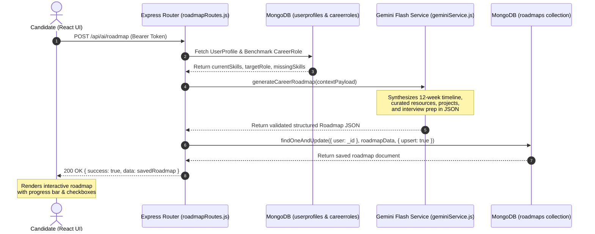

# Technical Architecture: AI-Powered Personalized Career Roadmap

---

## 1. Overview & Objective
Once a candidate identifies their skill gaps, generic advice like *"learn Docker"* or *"study cloud computing"* is often overwhelming and unguided.

The **AI Roadmap** feature uses **Google Gemini Flash** to synthesize a personalized, structured **12-week study and execution plan**. The curriculum is built around the candidate's exact background (current skills, target career role, experience level, and academic education) and specifically focuses on closing their missing core and optional skills.

---

## 2. Gemini AI Integration & Prompt Engineering

### 2.1. Model & SDK Integration
- **Engine**: Official Google Gen AI SDK (`@google/genai` / `GoogleGenAI`).
- **Model**: `gemini-2.5-flash` (low latency, high reasoning fidelity for technical curricula).
- **Format Guarantee**: Enforces `responseMimeType: "application/json"` with strict structured schema validation, preventing malformed responses or markdown parsing errors.

### 2.2. Contextual Prompt Assembly
The backend compiles a rich contextual payload from the candidate's MongoDB profile before querying Gemini:

```javascript
{
  userName: "Akshata",
  targetRole: "Full Stack Developer",
  experienceLevel: "Entry Level",
  education: {
    degree: "B.Tech Computer Science",
    graduationYear: 2026
  },
  currentSkills: ["React", "Node.js", "MongoDB", "JavaScript", "HTML", "CSS"],
  missingCoreSkills: ["TypeScript", "RESTful APIs", "Git"],
  missingOptionalSkills: ["Docker", "AWS", "Redis"]
}
```

The system prompt instructs Gemini to act as a **Principal Staff Engineer & Engineering Hiring Manager**, prioritizing foundational gaps in early weeks and advancing toward containerization, cloud deployment, and architectural patterns in later phases.

---

## 3. Data Pipeline & Architecture Diagram



---

## 4. Output Schema: The 4 Curriculum Pillars

Each generated roadmap contains four structured sections:

```
┌────────────────────────────────────────────────────────────────────────┐
│                          AI Roadmap Structure                          │
├────────────────────────────────────────────────────────────────────────┤
│ 1. Executive Summary & Learning Strategy                               │
│    • Narrative roadmap overview tailored to candidate background       │
├────────────────────────────────────────────────────────────────────────┤
│ 2. 12-Week Phased Timeline (Typically 3–4 Phases)                      │
│    • Phase 1 (Weeks 1–3): Core Deficiencies & Foundations              │
│    • Phase 2 (Weeks 4–7): Advanced Architecture & Integration          │
│    • Phase 3 (Weeks 8–10): Cloud, Containers & Infrastructure          │
│    • Phase 4 (Weeks 11–12): Capstone Project, Polish & Testing         │
│    • Each phase includes:                                              │
│      - Focus Skills                                                    │
│      - Concrete Action Items with [ ] isCompleted Checkboxes           │
│      - Curated Direct Resources (Docs, Official Tutorials, Courses)    │
├────────────────────────────────────────────────────────────────────────┤
│ 3. Hands-On Portfolio Projects                                         │
│    • Difficulty rating: Beginner / Intermediate / Advanced             │
│    • Demonstrates Skills: Gaps targeted by this project                │
│    • Architecture Highlights: Patterns implemented (e.g., Redis cache) │
├────────────────────────────────────────────────────────────────────────┤
│ 4. Technical Interview Focus Areas                                     │
│    • High-frequency recruiter & technical screen questions             │
└────────────────────────────────────────────────────────────────────────┘
```

---

## 5. Persistence & Interactive Progress Tracking

Unlike generic AI chat responses that disappear on page refresh, roadmaps are **first-class MongoDB documents** stored in the `roadmaps` collection:

1. **Persistent State**:
   - The roadmap is tied to `roadmaps.user`.
   - Logging in from any device immediately restores the candidate's active roadmap.
2. **Interactive Action Item Checkboxes**:
   - Every task in `timelinePhases[].actionItems` has an `isCompleted: Boolean` flag.
   - Clicking a task checkbox sends a `PATCH /api/ai/roadmap/action-item` request to the backend.
   - MongoDB updates the specific subdocument flag via array filters:
     ```javascript
     await Roadmap.updateOne(
       { user: req.user._id, "timelinePhases.actionItems._id": itemId },
       { $set: { "timelinePhases.$[].actionItems.$[elem].isCompleted": isCompleted } },
       { arrayFilters: [{ "elem._id": itemId }] }
     );
     ```
3. **Dynamic Completion Progress Bar**:
   - The UI computes completed tasks against total tasks:
     $$\text{Progress \%} = \frac{\text{Completed Action Items}}{\text{Total Action Items}} \times 100$$
   - Displays real-time visual progress as the candidate works through their curriculum.

