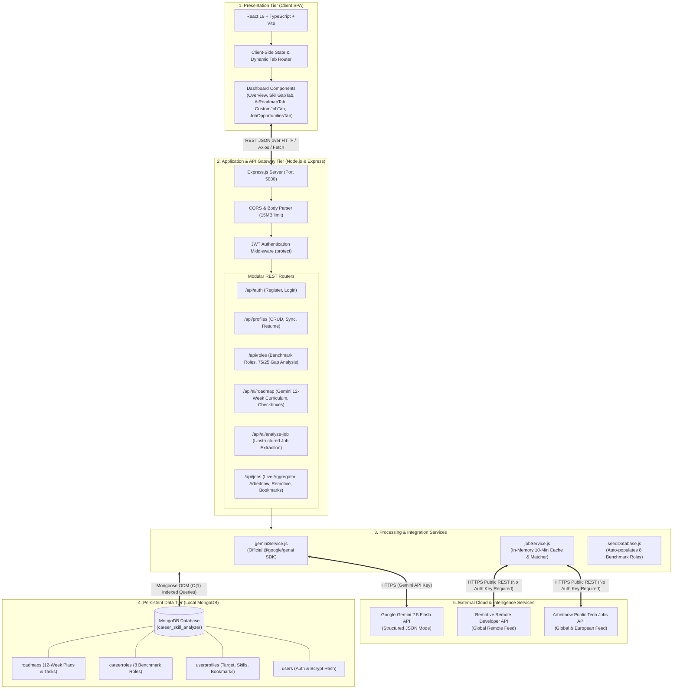
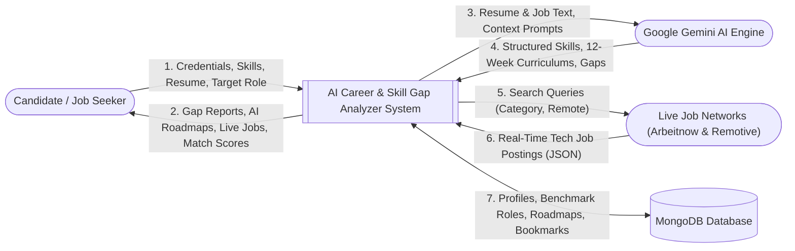
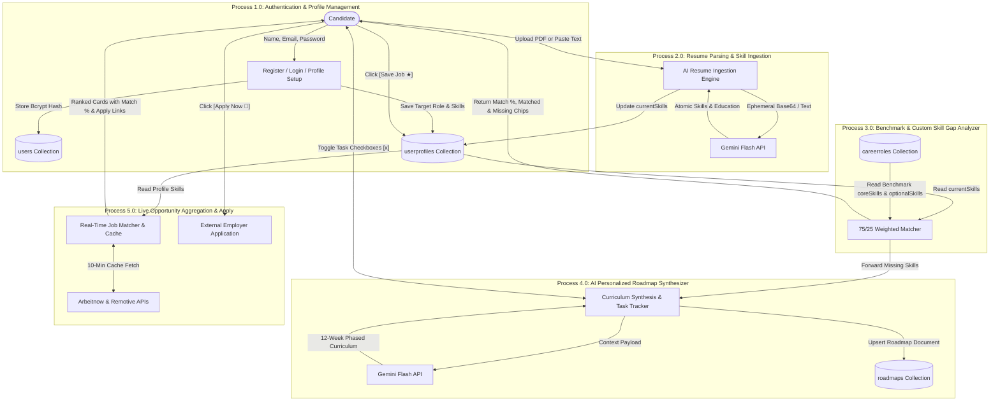

# Technical Architecture, Data Flow, Methodology & User Journey

---

## 1. Executive System Architecture

The **AI-Based Career and Skill Gap Analyzer** is designed around a scalable, modern 3-Tier Full-Stack Microservices Architecture with external AI and RESTful integrations:



---

## 2. Data Flow Diagrams (DFD)

### 2.1. Level 0 DFD (Context Diagram)
The Context Diagram illustrates the boundary of the system, external entities, and high-level data exchanges:



---

### 2.2. Level 1 DFD (Detailed Sub-System Processes)
This diagram decomposes the system into its 5 primary functional processes:



---

## 3. Engineering Methodology & Algorithms

The development methodology is grounded in **Evidence-Based Software Engineering (EBSE)** and **Human-in-the-Loop AI Collaboration**:

```
Stage 1: Ingestion & Normalization
  ├── Multimodal PDF Binary Buffer Extraction (RAM)
  └── Regex-driven Technical Tokenization & Alias Mapping
Stage 2: Deterministic Diagnostic Scoring
  ├── Set-Intersection Math for Verified Accuracy
  └── 75% Core / 25% Optional Weighting Matrix
Stage 3: Generative AI Personalization
  ├── Structured JSON Schema Mode (Google Gemini Flash)
  └── Prompt Constraints for Zero Hallucination
Stage 4: Market Alignment & Action
  ├── Real-Time Public API Aggregation & In-Memory Caching
  └── Direct Employer Application Handoff
```

### 3.1. Technical Skill Normalization Pipeline
To solve the industry problem of synonym fragmentation (e.g. `Node`, `Node.js`, `NodeJS` representing the same technology):
1. **Case & Space Normalization**: String converted to trimmed lowercase.
2. **Canonical Alias Resolution**: Mapped through `ALIAS_MAP`:
   - `k8s` $\rightarrow$ `kubernetes`
   - `ts` $\rightarrow$ `typescript`
   - `js` $\rightarrow$ `javascript`
   - `mongo` $\rightarrow$ `mongodb`
   - `postgres` $\rightarrow$ `postgresql`
   - `rest api` $\rightarrow$ `rest apis`
3. **Compound Token Containment**: Substring verification with a minimum 3-character threshold to prevent single-letter false matches.

### 3.2. Mathematical Evaluation Matrix
Recruiter hiring criteria prioritize mandatory skills over bonus competencies:

$$\text{Core Match Ratio } (R_c) = \frac{|\text{UserSkills} \cap \text{CoreSkills}|}{|\text{CoreSkills}|}$$

$$\text{Bonus Match Ratio } (R_b) = \frac{|\text{UserSkills} \cap \text{OptionalSkills}|}{|\text{OptionalSkills}|}$$

$$\text{Readiness Score} = \text{round}\left( (0.75 \cdot R_c + 0.25 \cdot R_b) \times 100 \right)$$

- **Readiness Classification**:
  - $\ge 80\%$: **Job Ready** (Eligible for technical screening).
  - $50\% - 79\%$: **Intermediate** (Viable candidate needing 2–3 targeted skills).
  - $< 50\%$: **Foundational** (Needs structural learning).

---

## 4. End-to-End User Journey Flowchart

```mermaid
flowchart TD
    Start(["User Visits Application"]) --> CheckAuth{"Is User Logged In?"}
    
    %% Unauthenticated Flow
    CheckAuth -->|"No"| Landing["Landing Hero Page\n(Feature Highlights, Project Architecture)"]
    Landing --> AuthModal["Auth Modal (Login or Register)"]
    AuthModal -->|"Submit Form"| JWT["Server Issues JWT Token & Auth User Object"]
    JWT --> Dash["Access Authenticated Dashboard"]

    %% Authenticated Flow
    CheckAuth -->|"Yes"| Dash

    Dash --> CheckProfile{"Does UserProfile Exist in MongoDB?"}
    CheckProfile -->|"No"| SetupProfile["Profile Setup View\n(Name, Degree, Target Role, Initial Skills)"]
    SetupProfile --> SaveProfile["POST /api/profiles/me (Save to MongoDB)"]
    SaveProfile --> DashOverview["Dashboard Overview Tab"]

    CheckProfile -->|"Yes"| DashOverview

    %% Main Navigation Paths
    DashOverview --> NavChoice{"Candidate Explores Tabs"}

    %% Path 1: Profile & Resume
    NavChoice -->|"Profile Settings"| EditProfile["Edit Profile & Skills Tab"]
    EditProfile --> UploadResume["Click 'Upload Resume with AI'"]
    UploadResume -->|"Upload PDF or Paste Text"| ParseAI["Gemini Flash Extracts Skills & Experience"]
    ParseAI --> ReviewSkills["Review & Edit Extracted Skill Chips"]
    ReviewSkills --> SaveProfile

    %% Path 2: Skill Gap Analysis
    NavChoice -->|"Skill Gap Analyzer"| GapTab["Skill Gap Analyzer Tab"]
    GapTab --> ViewGaps["View 75/25 Match % & Missing Core Skills"]
    ViewGaps --> RoleSim{"Explore Other Roles?"}
    RoleSim -->|"Yes"| SimModal["Select Role from Catalog\n(DevOps, AI, Backend, etc.)"]
    SimModal --> ViewGaps
    RoleSim -->|"Make Primary Target"| SaveTarget["Click 'Set as My Target Role'"]
    SaveTarget --> SaveProfile
    ViewGaps --> LaunchRoadmap["Click 'Generate AI Roadmap'"]

    %% Path 3: AI Roadmap
    NavChoice -->|"AI Roadmap"| RoadmapTab["AI Roadmap Tab"]
    LaunchRoadmap --> RoadmapTab
    RoadmapTab --> CheckRoadmap{"Roadmap Already Generated?"}
    CheckRoadmap -->|"No"| GenRoadmap["Click 'Generate Personalized Roadmap'"]
    GenRoadmap --> GeminiCall["Gemini Flash Synthesizes 12-Week Curriculum"]
    GeminiCall --> SaveRMap["Save to MongoDB (roadmaps collection)"]
    SaveRMap --> RenderRMap["Interactive 12-Week Roadmap\n(Phases, Projects, Interview Prep)"]
    CheckRoadmap -->|"Yes"| RenderRMap
    RenderRMap --> CheckTasks["Candidate Checks Off Action Items [x]"]
    CheckTasks --> PatchProgress["PATCH /api/ai/roadmap/action-item (MongoDB Update)"]

    %% Path 4: Custom Job Analysis
    NavChoice -->|"Analyze Custom Job"| CustomTab["Custom Job Tab"]
    CustomTab --> PasteJob["Paste Job Description from LinkedIn/Indeed"]
    PasteJob --> AnalyzeJob["Click 'Analyze Job Posting'"]
    AnalyzeJob --> GeminiExtract["Two-Tier Engine Extracts Skills & Computes Gap"]
    GeminiExtract --> CustomResult["View Match %, Core Gaps & Readiness Status"]
    CustomResult --> CustomActions{"Next Action"}
    CustomActions -->|"Adopt as Target"| SaveTarget
    CustomActions -->|"Build Curriculum"| LaunchRoadmap

    %% Path 5: Live Opportunities
    NavChoice -->|"Live Opportunities"| JobsTab["Live Opportunities Tab"]
    JobsTab --> FetchFeed["Real-Time Feed from Arbeitnow & Remotive APIs"]
    FetchFeed --> MatchCards["Render Cards with Candidate Match % & Skill Chips"]
    MatchCards --> FilterJobs["Filter by Keyword, Location, or 'Remote Only'"]
    FilterJobs --> MatchCards
    MatchCards --> JobActions{"Candidate Action"}
    JobActions -->|"Apply to Role"| DirectApply["Click '🚀 Apply Now'\n(Opens Employer Application Page)"]
    JobActions -->|"Deep AI Analysis"| TestAI["Click '⚡ Test with AI Analyzer'\n(Passes Job Text to Custom Analyzer Tab)"]
    TestAI --> CustomTab
    JobActions -->|"Save for Later"| Bookmark["Click '★ Save Job'"]
    Bookmark --> SaveBookmark["POST /api/jobs/save (Persist to userprofiles.savedJobs)"]
    SaveBookmark --> SavedView["Access from '⭐ Saved Bookmarks' Sub-Tab"]

    %% Logout
    DashOverview --> Logout["Click 'Log Out'"]
    Logout --> ClearStorage["Clear JWT & User from LocalStorage"]
    ClearStorage --> Landing
```



---

## 5. Security, State Management & Resiliency

| Dimension | Implementation Strategy | Security / Reliability Impact |
| :--- | :--- | :--- |
| **Authentication** | JSON Web Tokens (JWT) signed with secret key; 30-day expiration. | Stateless authentication; no server session storage required. |
| **Password Protection** | Bcrypt salted hashing with cost factor 10. | Resistance against rainbow tables and brute-force attacks. |
| **Route Protection** | Express middleware extracts Bearer token, verifies signature, injects `req.user`. | Unauthenticated clients are blocked from profile, roadmap, and bookmark APIs. |
| **Network Failover** | 10-minute in-memory cache + 6 curated benchmark partner jobs. | Guarantees live feed is never blank even during external API downtime or rate-limits. |
| **CORS & Payload Security** | Explicit CORS whitelist; Express JSON body parser capped at 15MB. | Prevents Cross-Origin Exploits and protects against Denial-of-Service buffer overloads. |
