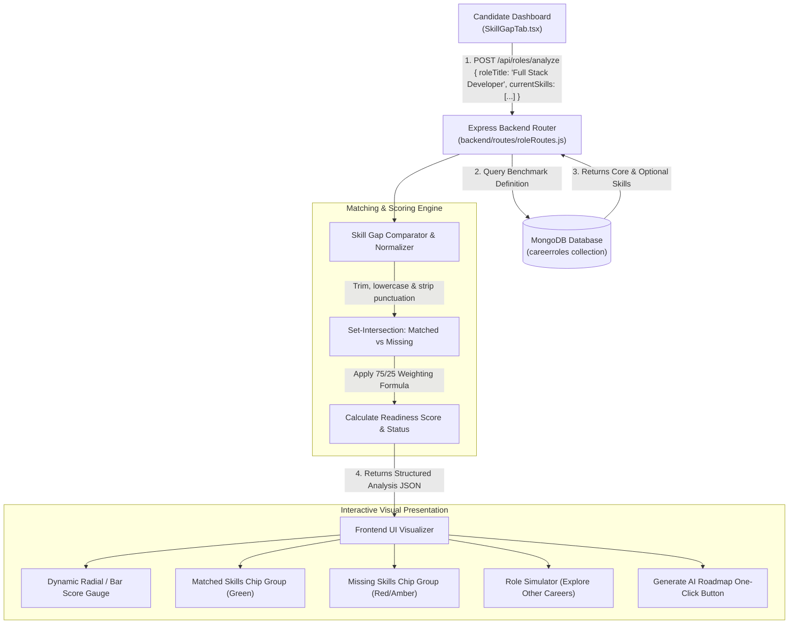

# Technical Architecture: Benchmark Skill Gap Analyzer

---

## 1. Overview & Objective
The **Skill Gap Analyzer** is the diagnostic core of the platform. It bridges the gap between what a candidate currently knows and what industry recruiters actually demand.

Rather than providing arbitrary scores or generic advice, the system performs a deterministic, weighted comparison between the candidate's verified skills (`userprofiles.currentSkills`) and curated industry benchmark roles (`careerroles`). It outputs granular gap metrics, categorizing skills into **Matched Core Competencies**, **Missing Core Requirements**, **Matched Bonus Skills**, and **Missing Bonus Skills**.

---

## 2. Mathematical Scoring Formula & Readiness Tiers

### 2.1. Weighted Evaluation Model
Recruiters treat mandatory core requirements significantly more strictly than optional nice-to-have bonus competencies. The analyzer reflects this by weighting core requirements at **75%** and optional skills at **25%**:

$$\text{Core Match \%} = \frac{|\text{Matched Core Skills}|}{|\text{Total Core Skills}|} \times 100$$

$$\text{Bonus Match \%} = \frac{|\text{Matched Optional Skills}|}{|\text{Total Optional Skills}|} \times 100$$

$$\text{Overall Readiness Score} = \text{round}\left( 0.75 \times \text{Core Match \%} + 0.25 \times \text{Bonus Match \%} \right)$$

*Edge Case Handling*: If a role does not define optional skills, core skills constitute 100% of the overall readiness score.

### 2.2. Readiness Tiers
Based on the computed score, the system categorizes the candidate into one of three industry readiness tiers:

| Score Range | Readiness Tier | Status Tone | Interpretation |
| :--- | :--- | :--- | :--- |
| **80% – 100%** | **Job Ready** | Emerald (`success`) | Strong candidate. Meets almost all core requirements and qualifies for recruiter screening. |
| **50% – 79%** | **Intermediate** | Amber / Blue (`info`) | Viable candidate with targeted gaps. Needs to acquire 2–3 specific core skills to become job-ready. |
| **0% – 49%** | **Foundational** | Crimson (`warning`) | Significant gap. Requires foundational learning before applying to this role. |

---

## 3. Data Pipeline & Architecture Diagram



---

## 4. Benchmark Role Dataset Structure
Benchmark roles are pre-seeded in the `careerroles` MongoDB collection. Each document defines industry-standard criteria verified against real job market requirements:

```javascript
{
  title: "Full Stack Developer",
  category: "Web Development",
  demandLevel: "Very High",
  description: "Designs and maintains both user-facing frontends and robust scalable backend services...",
  coreSkills: [
    "JavaScript",
    "TypeScript",
    "React",
    "Node.js",
    "Express",
    "MongoDB",
    "RESTful APIs",
    "Git",
    "HTML",
    "CSS"
  ],
  optionalSkills: [
    "Next.js",
    "Docker",
    "AWS",
    "GraphQL",
    "Redis",
    "Tailwind CSS",
    "CI/CD"
  ]
}
```

---

## 5. Key Features & User Experience

### 5.1. Dynamic Career Role Simulation
Candidates are not locked into analyzing only their saved target role:
- The candidate's default analysis loads their saved `userprofiles.targetRole`.
- The candidate can use the **Role Selector Dropdown** or **Explore Roles Modal** to test their current skills against any other industry role (e.g., *"How close am I to a DevOps Engineer or Data Scientist with my current skillset?"*).
- Simulating other roles does **not** overwrite the user's profile in MongoDB unless they explicitly click **"Set as My Target Role"**.

### 5.2. Granular Gap Breakdown
The UI presents distinct visual sections:
- **Core Competencies Met**: Displayed with green checkmarks (`✓ React`, `✓ Node.js`).
- **Critical Skill Gaps**: Displayed with red plus chips (`+ Docker`, `+ AWS`). These are fed directly into the AI Roadmap generator to build targeted study phases.
- **Bonus Competitive Edge**: Displays optional technologies that give the candidate an advantage over other applicants.

### 5.3. One-Click AI Roadmap Generation
When a candidate reviews their missing skills, clicking **"Generate AI Roadmap"** transitions them to the AI Roadmap tab and pre-populates their missing skills into the Google Gemini curriculum generator.
